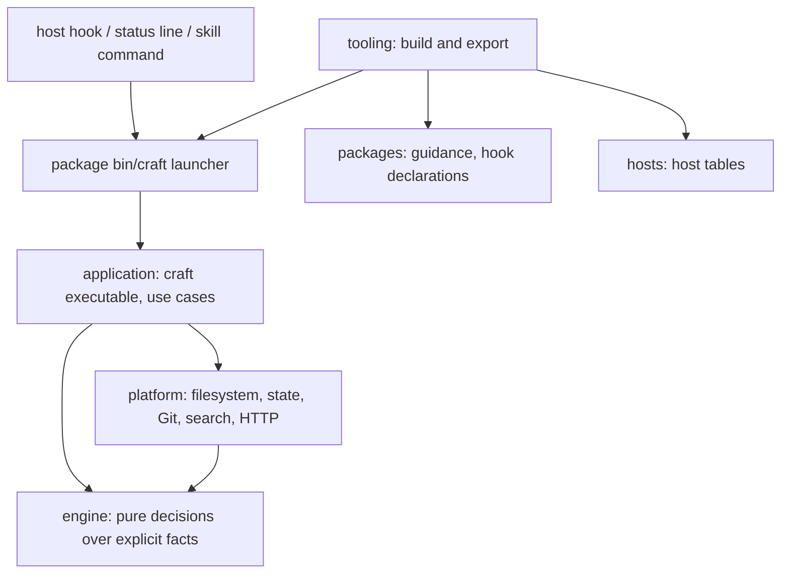

# Architecture

Craft Capabilities has two halves: agent-facing content (skills, workflows, standards) and
one native executable, `craft`, that makes the deterministic decisions behind them. The
build turns both into a bundle per host.

## Components

| Location | Owns |
|---|---|
| `packages/` | Four installation units (engineering, delivery, review, stories): guidance, workflows, standards, evals and hook declarations |
| `engine/` (`craft-engine`) | Pure decisions over explicit JSON facts: project contracts and effective settings, routing and the embedded catalog, discovery plans, sessions, tasks, attempts and acceptance coverage, checkpoints, workers and actions, review artifacts and the read-only guard, model advice, service plans, telemetry envelopes and OTLP mapping |
| `platform/` (`craft-platform`) | Filesystem, bounded documents, state records and their lock protocol, Git observation, processes, literal search, Project Intelligence storage and syntax providers, bounded HTTP, the local telemetry store |
| `application/` (`craft-application`) | The `craft` executable: CLI parsing and rendering, host hook payloads and wire output, the status line, and each use case that combines observations, decisions and persistence |
| `hosts/` | Host hook mapping, session and feature tables; the build reads them and `craft` embeds them |
| `tooling/` | Build, export, release, validation and evaluation drivers |
| `schemas/` | Published authoring schemas for capability manifests, the catalog and project configuration |

`engine/` decides, `platform/` observes and persists, `application/` orchestrates and owns
the executable. `architecture.json` declares the module map, dependency directions and where
JavaScript may live; `npm run architecture` enforces them
([ADR 0002](adr/0002-module-map-and-boundaries.md)). The runtime is Rust
([ADR 0001](adr/0001-rust-core-runtime.md)); no runtime JavaScript ships.

## Interaction

Every runtime path is one `craft` process started through the package launcher:

- **Hooks.** The host runs `craft hook <host> <lifecycle>`. `craft` reads the payload
  (64 KiB bound), maps it to host-neutral lifecycle facts with the embedded host table, runs
  observation, the read-only review guard or context delivery (routing hints, checkpoints,
  service metadata, hint reuse), and writes the host's wire output.
- **Commands.** Skills and users run `craft <command>` for routing, lookup, sessions, tasks,
  checkpoints, service plans, review artifacts, acceptance views and telemetry reports
  ([commands](COMMANDS.md)).
- **Status line.** `craft statusline <host>` reads the host's status-line payload and writes
  one line of session status.
- **Host controls.** An integration the consumer owns drives worker, review and compaction
  phases as JSON requests on standard input; its own transport acts between phases, outside
  every lock ([host controls](HOST-CONTROL.md)).

Remote telemetry, when configured, is posted after the process writes its output
([observability](OBSERVABILITY.md)).

## Constraints

- The engine reads no files, processes, environment or clock; time-sensitive decisions take
  an explicit clock value. Callers branch on stable error codes, never on diagnostic prose.
- `craft` returns plans and advice. It does not call models, switch profiles, execute remote
  operations, compact a host session or publish findings. Nothing in a package or project
  configuration grants permission or loads executable code.
- Missing or incomplete observations stay unknown: guidance size is not context occupancy,
  pack activity is not provider usage, and a hook file is not proof that hooks run
  ([sessions](SESSION.md)).
- State is private, bounded, symlink-checked and atomically replaced under one lock protocol
  ([state storage](SESSION.md#state-storage)). Cached evidence is bound to the session, task,
  revision and scoped file versions that produced it.
- Unsupported host enforcement and observations remain visible in each export's adapter
  report rather than being simulated ([adapters](ADAPTERS.md)).

## Exports

Each exported package is self-contained: its skills, resources, hook configuration, the
generated `bin/craft` and `bin/craft.cmd` launchers and the native executables under
`support/native-bin/<target>/`. Installed packages run after relocation without Node,
authoring scripts or sibling packages. Builds validate source, stage output and refuse
unmanaged or symlinked targets. `package.json` holds the pack version; package and runtime
metadata are synchronized projections checked before every build. Deterministic checks
establish packaging and contract correctness, not model quality
([evaluation](EVALUATION.md)).
