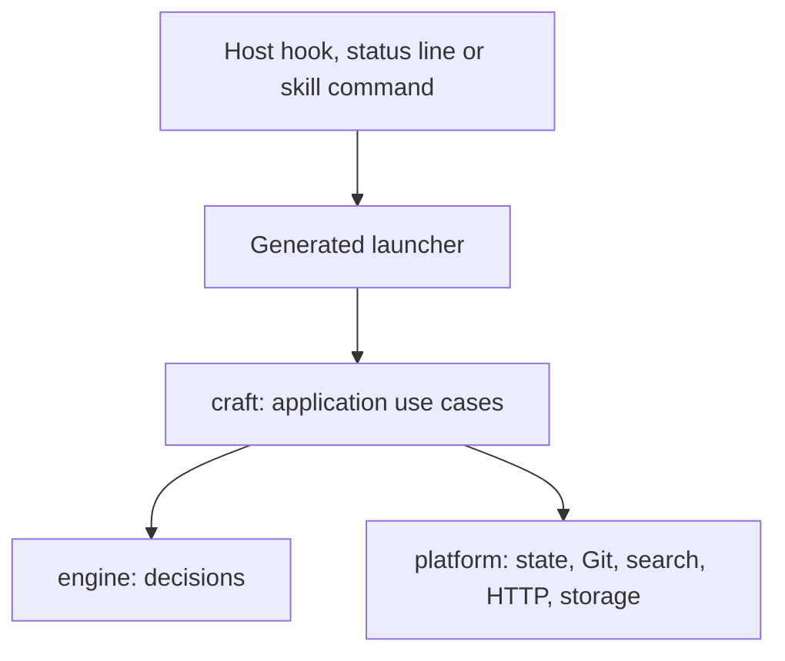

# ADR 0001: Rust owns the core runtime

Status: Accepted — 2026-10-22

## Context

Local runtime behavior (routing, state, sessions, telemetry, hooks) was written in
JavaScript. Project Intelligence needed native parsing and persistent evidence storage.
Splitting new capabilities across two runtime languages would create competing owners for
state, policy and lifecycle behavior.

## Decision

The core runtime is Rust: engine decisions, Project Intelligence, state, routing, telemetry,
context, cache and persistence, together with their orchestration and I/O. It ships as one
prebuilt, relocatable `craft` executable per supported platform.

Build tooling, tests and packaging stay JavaScript. Host-specific code is limited to data
tables read at build time and generated launchers that only select the bundled executable;
hooks, the status line and every command run `craft` directly. New runtime behavior belongs
in Rust, never in an adapter.

Structure follows ownership, not history: pure decisions, orchestration and I/O stay
separate, and a separate crate exists only where it enforces a useful boundary
([ADR 0002](0002-module-map-and-boundaries.md)).

## Alternatives

A permanent mixed runtime keeps ownership of new behavior ambiguous. A runtime in
JavaScript with native extensions keeps Node as an installation requirement for every host
and every hook call.

## Consequences

Each runtime behavior has one implementation owner. Contributors need a Rust toolchain;
consumers need a compatible bundled executable, not a compiler. Platforms without an
executable are reported explicitly instead of degrading silently. State formats, digest
identities and error codes are compatibility contracts. Each call starts one process, so
frequently repeated decisions are batched by their use case rather than by a daemon.
Language choice alone establishes no performance or model-quality improvement; those need
measurements.

Revisit this decision if a required host cannot run a native executable, or measured
deployment constraints make it unsuitable. Exceptions need their own decision, not a growing
adapter.
