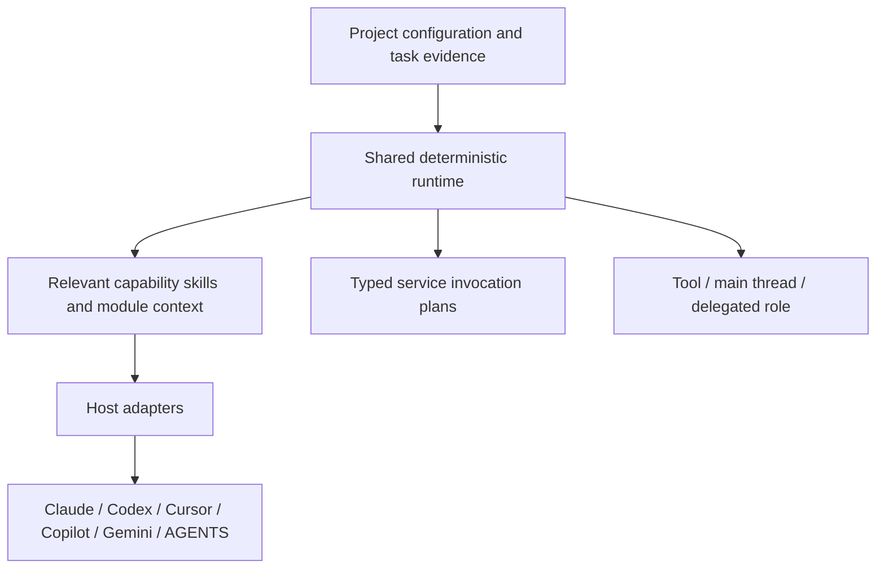

# Architecture

Four installation units cover engineering craft, delivery, change review and product stories.
Language and agent disciplines live within craft-engineering because they share its grounding,
testing and quality concerns. Selective skill loading gives specialization without making
every discipline a separate package dependency.

There are three distinct boundaries:

1. **Capability content** owns workflows, standards, skills and eval cases.
2. **Shared runtime** owns deterministic routing, service-operation planning and checkpoint
   state. It does not call a model, execute a remote operation or spawn a worker.
3. **Host adapters** own discovery paths, native names, hook events and wire responses.
   **Service bindings** separately map Git, codehost and tracker operations to CLI/MCP tools.

Host, language, application layer and agent provider remain independent. Module ownership
and dependencies come from the consumer, not a fixed list of repositories. File extensions
are evidence for language; they are not proof of an architecture. A route declares what
needs loading and what is missing, with tool/skill availability explicitly unverified until
the host checks it.

Shared hook handlers are pure. Adapter wrappers normalize events; the runtime may read trusted
project configuration and write opt-in checkpoint state; handlers return data. Unsupported
context injection or lifecycle events are reported. Instructions are suggestions, not a claim
that a host enforces them. Tool-side authorization remains separate.

`craft-review` consumes immutable local Git snapshots and validates structured findings.
Interactive use and bots share that method. Publication is a separate authorized job with
fresh revision checks. The optional personal inbox lives under `tools/craft-review-inbox`, outside
default capability exports.

Builds validate source, stage generated exports and refuse unmanaged/symlinked output.
The same canonical runtime is copied into each exported package’s `support/runtime` so an
installed package never imports the authoring tree or a versioned sibling package. One source
is maintained; copies are build artifacts. All source versions stay at 0.0.1 during this initial
iteration. Evals separate packaging correctness from actual model behavior.
