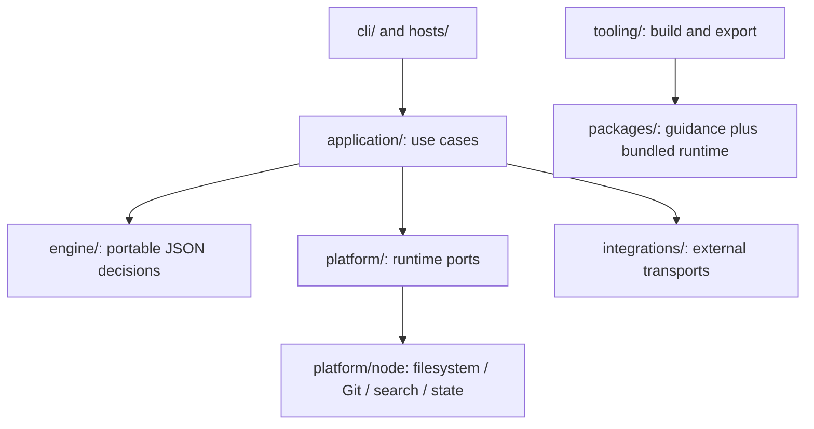

# Architecture

Capability content lives in `packages/`. Four installation units cover engineering,
delivery, review and product stories. Languages and application/provider disciplines
remain independently selected guidance within craft-engineering.



## Ownership

| Location | Owns |
|---|---|
| `engine/contracts/` | Project/catalog contracts and portable path validation |
| `engine/routing/` | Guidance selection, module/delegation decisions, generic operation plans |
| `engine/discovery/` | Independent lookup batches, bounded matching and compact results |
| `engine/cache/` | Reuse validity and deterministic identities |
| `engine/session/` | Context estimates, occupancy recommendations, activity and attempt budgets |
| `engine/policy/` | Model advice, context delivery, review and inbox decisions |
| `engine/checkpoint.mjs` | Small continuation contracts, source binding and comparison |
| `application/` | Observation collection and execution of concrete local use cases |
| `application/{routing,discovery,session}/` | Related use cases grouped by feature |
| `platform/index.mjs` | Wiring for bounded observation/storage operations |
| `platform/node/` | Concrete Node ports; repository and resource observations are grouped separately |
| `integrations/` | External Git/codehost command syntax, observation normalization and output projections |
| `hosts/` | Native host payloads, telemetry, capability declarations, controls and wire output |
| `cli/` | Arguments, help and text display |
| `tooling/export/` | Build-time platform exporters |

Folders represent features with multiple responsibilities. Small features remain files.
Top-level names identify ownership: `engine/` decides, `application/` orchestrates,
`platform/` implements runtime/OS access, `hosts/` adapts coding-agent hosts,
`integrations/` maps external systems, `cli/` handles human input/output,
`tooling/` builds and validates, and `packages/` contains agent-facing guidance.
No former runtime, adapter or script paths are retained as forwarding modules.
The accepted module map, dependency directions and runtime JS budgets are declared in
`architecture.json` and [ADR 0002](adr/0002-module-map-and-boundaries.md); `npm run architecture` enforces them.

## Engine contract

`engine/index.mjs` exports `evaluate(request)`. Requests and responses contain only JSON:

```json
{"formatVersion":1,"operation":"attempt-status","input":{"operation":"implement","records":[]}}
```

Success returns `{ "formatVersion": 1, "ok": true, "result": ... }`. Failure returns
`ok: false` with a stable `error.code` (`UNSUPPORTED_VERSION`, `UNKNOWN_OPERATION`, or
`INVALID_INPUT`) and a diagnostic message. Callers must not branch on message prose.
Inputs are copied before evaluation; no caller-owned objects are mutated. Clocks,
repository versions, file observations, host capabilities and catalog data are explicit
inputs. Time-sensitive advice requires an explicit clock value.

The engine imports only its own portable modules. It does not read files, invoke Git,
use Node globals, inspect environment variables or interpret native host payloads.
Application use cases call the public boundary through `application/engine-client.mjs`,
which only serializes requests and unwraps responses. Catalog loading and provider facts
belong to the relevant use cases;
Node implementations do not import application logic or engine policy. Application code
imports only `platform/index.mjs`, never `platform/node/` details. The platform entry point
wires the current Node implementation without introducing a second infrastructure layer. Port callbacks stay within application/Node orchestration; they never cross the JSON engine boundary.

The target core runtime is Rust, as established by [ADR 0001](adr/0001-rust-core-runtime.md).
This includes local orchestration, state, routing, telemetry, context, cache and persistence,
as well as pure engine decisions and Project Intelligence. A dedicated incremental
migration moves complete use cases from JavaScript into Rust, preserving compatibility
and removing each replaced implementation after verification.
New runtime capabilities belong in Rust. Host adapters and packaging may remain thin
JS/TS where needed. The ownership map above describes the current layout, not a requirement
to reproduce its folders or layers during migration. Simplify structure when useful while
preserving public contracts and separation of pure decisions from I/O. Contract replay
and dependency tests continue to protect those boundaries.

## Evidence and effects

Pack context measures selected guidance; current occupancy requires fresh, session-bound
host observations. Pack activity counts its own receipts, never provider usage. Missing or
incomplete observations stay unknown. See [session behavior](SESSION.md).

Discovery batches only known independent literal lookups. Cached evidence is bound to
session/task, HEAD, scoped inventory/file versions, manifests/config and implementation
identity. Unavailable evidence triggers fresh discovery. Hint reuse separately records only
successfully emitted context; lifecycle invalidation survives an in-flight delivery.

Checkpoint, activity and hint state share bounded, symlink-checked, atomic file storage,
with separate formats and lifecycles. Automatic Git snapshots cannot renew the source
binding of older continuation notes. A reset recommendation requires a fresh continuation.

Opt-in engineering contracts and criterion evidence share the existing locked task state.
The engine computes coverage from the observed source and attributed assessments; the
application observes Git and persists decisions atomically. Structured session version 2
rejects incompatible writers, while legacy tasks retain version 1 and declared assurance.
The evidence ledger survives attempt-history eviction; contract and ledger digests fence
replacement writes. See [acceptance contracts](ACCEPTANCE.md).

Worker reservations use one bounded private ledger per coordinator root/session/task across
processes. Native worker and action phases persist intent and release locks before the
integration's host transport acts; the engine decides admission and reconciliation from
explicit JSON facts.
Review/compaction execution receipts live with their existing action proposals and survive
proposal cleanup. No executable adapter is loaded from project configuration. See the
[host controls](HOST-CONTROL.md) for phases, operation keys, fencing and native limits.

The engine returns plans and advice. It does not call models, switch profiles, execute
remote operations, compact a host session or publish findings. Context-delivery policy
receives lifecycle facts, not hook event names. Each hook command starts `craft hook` through a
generated launcher; `craft` parses the host payload, runs lifecycle observation, the read-only
review guard or context delivery (routing hints, checkpoints, service metadata and hint reuse)
and writes the host's wire output, one process per hook.
Host lifecycle controls belong to `hosts/`; external service mappings belong to
`integrations/`. Neither grants permission. Unsupported host enforcement and observations remain visible in reports.

## Packages and exports

Package names, manifests and useful bin/hook entry points remain external interfaces.
The builder copies canonical `engine/`, `application/`, `platform/`, `integrations/`, `hosts/` and `cli/` into
each package's `support/`, and rebases shared imports in package entry points. Installed
packages run after relocation without authoring scripts or sibling package dependencies.
Full bundles also expose these directories at their root. No legacy runtime paths or
fallback loaders are retained. Each package's generated `bin/craft` and `bin/craft.cmd`
launchers select its bundled native executable for hooks, native tools and the status line.

The optional inbox remains under `tools/craft-review-inbox/` because it owns separate
consumer configuration, remote pagination, checkout and review-artifact lifecycles. Its
shared status and authorization decisions now use the engine, and external command
recognition uses integrations. It runs from the repository checkout and stays excluded
from default exports. Its separate I/O is retained rather than merging remote inbox state
with session checkpoint state.

Builds validate source, stage exports and refuse unmanaged or symlinked output. The canonical pack version is `package.json.version`; package and runtime
metadata are synchronized projections checked before every build. Deterministic checks establish packaging and contract correctness; they do
not establish model quality or an efficiency improvement.

## Supporting telemetry

`application/telemetry/events.mjs` defines a bounded JSON envelope and metadata allowlists.
Application use cases emit at operation boundaries. `platform/index.mjs` exposes local
storage, scoped identity, version, clock and bounded HTTP ports; their Node implementations
remain under `platform/node/`. `integrations/otel/` maps sanitized envelopes to OTLP JSON.
The engine imports neither telemetry runtime nor providers. Provider objects never cross
its JSON boundary or enter the application event contract. No separate top-level telemetry
subsystem or event bus is needed. See [observability and privacy](OBSERVABILITY.md).

Telemetry trace scopes use public platform context ports; Node implements async context
isolation in its existing telemetry module. The portable event/context contract remains
plain JSON. Application boundaries own spans and reason codes; transport mappings own
OTLP serialization. See the [observability coverage matrix](OBSERVABILITY.md#coverage-and-deliberate-limits)
for diagnostics, bounded loss behavior and the zero-model-cost contract.

## Developer acceptance flow

The developer workflow composes context through `craft grounded-context`,
then uses existing task-start/step/status operations for contracts and evidence.
The caller interprets constraints and assesses check adequacy/artifact availability;
the engine projects attributed criterion coverage against the checked binding.
No new scheduler, role store or check executor is introduced. The fixed
developer pilot in source-checkout `examples/evals/developer-acceptance/README.md` exercises that
composition with real behavior checks; guidance-only work retains the same evidence
limits manually. Structured persistence stays opt-in.
