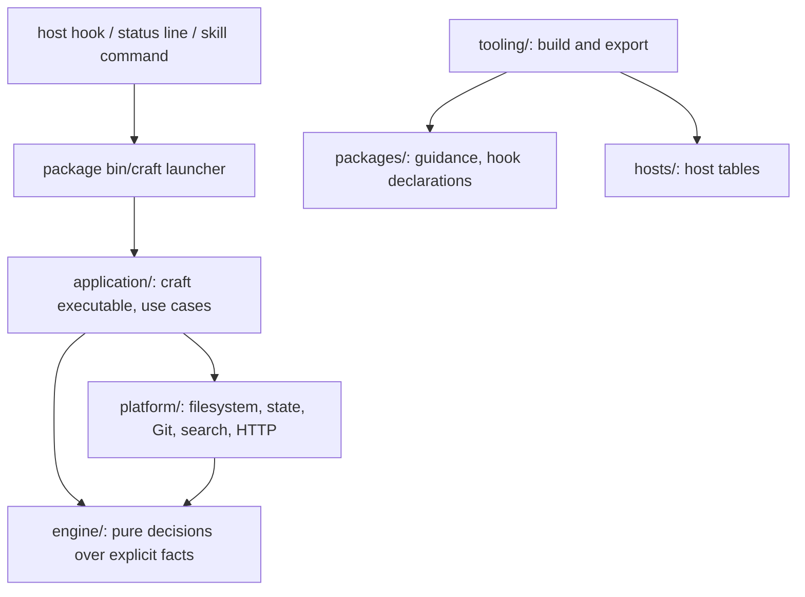

# Architecture

Capability content lives in `packages/`. Four installation units cover engineering,
delivery, review and product stories. Languages and application/provider disciplines
remain independently selected guidance within craft-engineering.

## Ownership

| Location | Owns |
|---|---|
| `engine/` (`craft-engine`) | Pure decisions over explicit JSON facts: project contracts and effective settings, routing and the embedded catalog (`engine/routing/catalog.json`), discovery plans, sessions, tasks, attempts and acceptance coverage, checkpoints, workers and actions, review artifacts and the read-only guard, model advice, service plans, telemetry envelopes and OTLP mapping |
| `platform/` (`craft-platform`) | Filesystem, bounded documents, state records and their lock protocol, Git observation, processes, literal search, Project Intelligence storage and syntax providers, bounded HTTP, the local telemetry store |
| `application/` (`craft-application`) | The `craft` executable: CLI parsing and rendering, host hook payloads and wire output, the status line, and each use case that combines observations, decisions and persistence |
| `hosts/` | Host hook mapping, session and feature tables; the build reads them and `craft` embeds them |
| `packages/` | Agent-facing guidance, workflows, standards, evals and hook declarations |
| `tooling/` | Build, export, release, validation and evaluation drivers |

`engine/` decides, `platform/` observes and persists, `application/` orchestrates and owns the
executable. The engine reads no files, processes, environment or clock; time-sensitive
decisions take an explicit clock value. Callers branch on stable error codes, never on
diagnostic prose. The accepted module map, dependency directions and JavaScript budgets are
declared in `architecture.json` and [ADR 0002](adr/0002-module-map-and-boundaries.md);
`npm run architecture` enforces them. The core runtime is Rust
([ADR 0001](adr/0001-rust-core-runtime.md)); no runtime JavaScript ships.

## Evidence and effects

Pack context measures selected guidance; current occupancy requires fresh, session-bound
host observations. Pack activity counts its own receipts, never provider usage. Missing or
incomplete observations stay unknown. See [session behavior](SESSION.md).

Discovery batches only known independent literal lookups. Cached evidence is bound to
session/task, HEAD, scoped inventory/file versions, manifests/config and implementation
identity. Unavailable evidence triggers fresh discovery. Hint reuse separately records only
successfully emitted context; lifecycle invalidation survives an in-flight delivery.

Checkpoint, activity and hint state share bounded, symlink-checked, atomic file storage,
with separate formats and lifecycles. Automatic Git snapshots cannot renew the source
binding of older continuation notes. A reset recommendation requires a fresh continuation.

Opt-in engineering contracts and criterion evidence share the existing locked task state.
The engine computes coverage from the observed source and attributed assessments; the
application observes Git and persists decisions atomically. Structured session version 2
rejects incompatible writers, while legacy tasks retain version 1 and declared assurance.
The evidence ledger survives attempt-history eviction; contract and ledger digests fence
replacement writes. See [acceptance contracts](ACCEPTANCE.md).

Worker reservations use one bounded private ledger per coordinator root/session/task across
processes. Native worker and action phases persist intent and release locks before the
integration's host transport acts; the engine decides admission and reconciliation from
explicit JSON facts.
Review/compaction execution receipts live with their existing action proposals and survive
proposal cleanup. No executable adapter is loaded from project configuration. See the
[host controls](HOST-CONTROL.md) for phases, operation keys, fencing and native limits.

The engine returns plans and advice. It does not call models, switch profiles, execute
remote operations, compact a host session or publish findings. Context-delivery policy
receives lifecycle facts, not hook event names. Each hook command starts `craft hook` through a
generated launcher; `craft` parses the host payload, runs lifecycle observation, the read-only
review guard or context delivery (routing hints, checkpoints, service metadata and hint reuse)
and writes the host's wire output, one process per hook.
Host lifecycle tables belong to `hosts/`; external service mappings are plans in the engine.
Neither grants permission. Unsupported host enforcement and observations remain visible in reports.

## Packages and exports

Package names, manifests and useful bin/hook entry points remain external interfaces.
Each exported package carries generated `bin/craft` and `bin/craft.cmd` launchers that select
its bundled native executable (`support/native-bin/<target>/`) for hooks, commands and the
status line; installed packages run after relocation without Node, authoring scripts or
sibling packages. Hook files only name a native handler.

Builds validate source, stage exports and refuse unmanaged or symlinked output. The canonical pack version is `package.json.version`; package and runtime
metadata are synchronized projections checked before every build. Deterministic checks establish packaging and contract correctness; they do
not establish model quality or an efficiency improvement.

## Supporting telemetry

The engine defines the bounded schema-1 event envelope and its attribute allowlists and maps
stored events to OTLP JSON. Use cases record operations and observations under one trace per
invocation; `platform/` stores them in the private local log and posts an opt-in remote export
over bounded HTTP after the command's output is written. No provider objects cross the event
boundary. See the [observability coverage matrix](OBSERVABILITY.md#coverage-and-deliberate-limits)
for diagnostics, bounded loss behavior and the zero-model-cost contract.

## Developer acceptance flow

The developer workflow composes context through `craft grounded-context`,
then uses existing task-start/step/status operations for contracts and evidence.
The caller interprets constraints and assesses check adequacy/artifact availability;
the engine projects attributed criterion coverage against the checked binding.
No new scheduler, role store or check executor is introduced. The fixed
developer pilot in source-checkout `examples/evals/developer-acceptance/README.md` exercises that
composition with real behavior checks; guidance-only work retains the same evidence
limits manually. Structured persistence stays opt-in.
