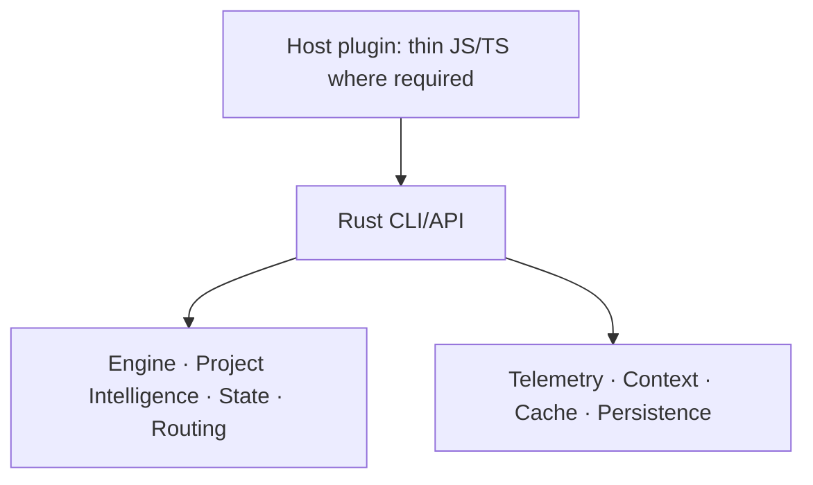

# ADR 0001: Rust owns the Engineering Pack core runtime

Status: Accepted — 2026-10-22

## Context

The Pack currently implements most local runtime behavior in JavaScript. Project
Intelligence introduces native parsing and persistent evidence storage. Keeping new
capabilities split across two runtime implementations would create competing owners
for state, policy and lifecycle behavior. We need a clear destination while retaining
working host integrations and allowing incremental delivery.

## Decision

The Engineering Pack core runtime is implemented in Rust. This is the architectural
target and the rule for new runtime capabilities; it does not claim the existing
JavaScript runtime has already migrated.

Rust owns engine decisions, Project Intelligence, state, routing, telemetry, context,
cache and persistence, including their local application orchestration and runtime I/O.
Host-specific adapters may use the language required by the host, including
JavaScript/TypeScript. Packaging and build tooling may remain JavaScript/TypeScript.
Adapters stay thin: host event translation, native invocation and host response
serialization. New capabilities must not introduce substantial JavaScript/TypeScript
runtime logic or move domain decisions into adapters.

Existing JavaScript/TypeScript runtime components migrate opportunistically when
affected by feature work, rather than through a standalone rewrite. Each migration
preserves relevant public contracts, state compatibility, authorization behavior and
observable outcomes, then removes the replaced runtime implementation. Unaffected
legacy components may remain until work reaches them; new runtime logic belongs in Rust.

Migration may simplify folders, interfaces and layers when the changed behavior
demonstrates that they are unnecessary or duplicate ownership. Rust need not reproduce
the JavaScript directory or abstraction structure. Keep useful separation between pure
decisions, orchestration, I/O and host transport; use separate crates only when they
enforce a useful boundary. Structural changes stay scoped, reviewable and verified
against the contracts they affect.

## Alternatives

A permanent mixed core would preserve the current language split but leave ambiguous
ownership for new runtime behavior. A standalone rewrite would postpone useful feature
delivery and enlarge the compatibility surface of each change. Neither is the selected
delivery approach.

## Consequences

New core capabilities have one implementation owner. Contributors need Rust tooling;
installed consumers need a compatible, relocatable native artifact rather than a compiler.
Host adapters and packaging must report unavailable native support explicitly.

Temporary coexistence requires explicit contracts and migration tracking. Existing
state formats, digest identities and error behavior need compatibility checks before
replacement. Frequently called decisions require a suitable API or batching boundary;
spawning a CLI process per small decision is not an assumed solution. Language choice
alone establishes no performance or model-quality improvement.

Revisit this decision if a required host cannot support a practical native boundary or
measured deployment constraints make the architecture unsuitable. Exceptions require
an explicit architectural decision, not an expanding adapter implementation.
